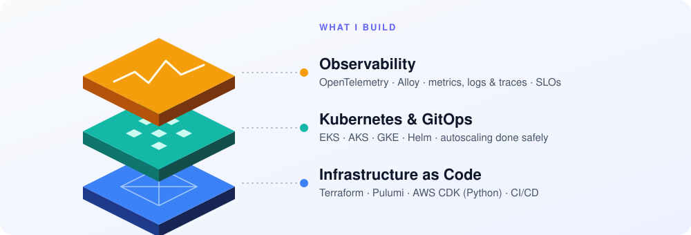

  

### Hi, I'm Dilshan 👋

Cloud Platform Engineer based in Amsterdam, with 10+ years of designing and leading scalable, secure cloud platforms across AWS, Azure and GCP. These days I lead the infrastructure behind an AI-powered stroke care platform at [Nicolab](https://nicolab.com).

I specialise in Kubernetes and platform engineering, and I've owned platform architecture and strategy supporting 70+ engineering teams and more than 500 engineers through automation, standardisation and governance. What I care about most is reliability, security, cost efficiency and developer experience. Outside of work I watch planes, which is how my favourite side project started.

  

  

### 🛫 How I got here

  

I started out supporting trading platforms, moved into systems engineering for travel, and grew into DevOps on analytics and machine-learning products. From there I led DevOps for fintech systems, drove reliability work as an SRE for an auctions and automotive platform, and ran a shared EKS platform for a large European e-commerce company. Today I own the multi-cloud Kubernetes setup at Nicolab, migrating from GCP to AWS along the way.

---

### ✈️ Featured project

**[OpenFlightWall](https://dilshanonline.github.io/OpenFlightWall/)** shows the planes flying over you in real time: live flight cards, a moving map, "overhead now" alerts and a full-screen wall mode for a TV or Raspberry Pi. It's free, keyless and open source, built with Flask on community data sources, and ships as a multi-arch Docker image.

[Try the demo](https://dilshanonline.github.io/OpenFlightWall/demo/) · [Repo](https://github.com/dilshanonline/OpenFlightWall) · [Read the story](https://dilshanw.medium.com/openflightwall-how-i-turned-my-plane-watching-habit-into-a-free-flight-dashboard-3b72536adb31) · `docker run -p 5050:5050 dilshanonline/openflightwall:latest`

### 🛠 Other tools

- **[ecr_migration_script](https://github.com/dilshanonline/ecr_migration_script)** – a safe Python CLI for moving container images from Google Artifact Registry to AWS ECR, with dry-runs, tag filtering and digest validation.
- **[s3-sync](https://github.com/dilshanonline/s3-sync)** – a Helm chart for a Kubernetes CronJob that syncs data from an S3 bucket in another AWS account onto EFS in an EKS cluster, using IRSA for cross-account access and mirroring deletions.

### ✍️ Writing

I write on [Medium](https://dilshanw.medium.com/) about lessons from real migrations and incidents. A few favourites:

- [We broke our EKS Cluster Autoscaler during the AL2023 migration, and fixed it](https://dilshanw.medium.com/we-broke-our-eks-cluster-autoscaler-during-amazon-al2023-migration-and-fixed-it-heres-what-we-5c835299f986) – IRSA, RBAC and why AMI upgrades are application changes.
- [Migrating container images from GCP to AWS ECR safely](https://dilshanw.medium.com/migrating-container-images-from-gcp-to-aws-ecr-safely-and-efficiently-eb537f7a50c3) – the story behind the migration tool.
- [OpenFlightWall: how a plane-watching habit became a free flight dashboard](https://dilshanw.medium.com/openflightwall-how-i-turned-my-plane-watching-habit-into-a-free-flight-dashboard-3b72536adb31)

### 🎓 Education

MSc in Information Technology (Cyber Security) and BSc (Hons) in Information Technology, both from SLIIT, Sri Lanka.

### 📫 Find me

[Email](mailto:info@dilshanwijesooriya.me) · [Website](https://dilshanwijesooriya.me/) · [Medium](https://dilshanw.medium.com/) · [LinkedIn](https://www.linkedin.com/in/dilshanwijesooriya/) · [X](https://twitter.com/dilshanonline)
